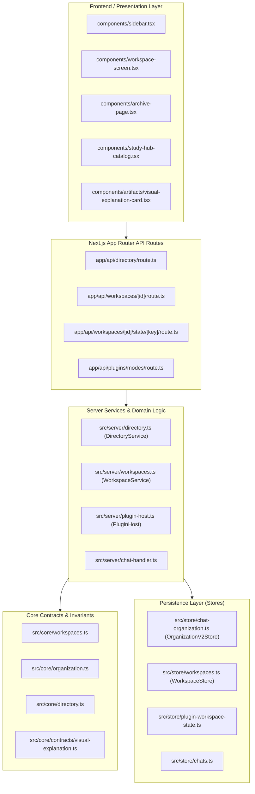

# Report RUN 10 — Final Integrated Architecture & Release Readiness Audit

**Data**: 18 Novembre 2026  
**Autore**: Antigravity (Gemini 3.8 Flash)  
**Repository**: `MrJoelao/learnharness`  
**Branch Target**: `feat/study-hub`  
**Ultimo HEAD Confermato**: `5191c562378fcae4788a72ef666e34953407774c`  
**Modalità di Esecuzione**: Rigorosamente READ-ONLY (nessuna modifica al codice applicativo o ai file preesistenti)

---

## 1. Executive Summary

La **RUN 10** costituisce l'audit tecnico integrato finale e indipendente del branch `feat/study-hub` di LearnHarness prima della potenziale integrazione verso `dev`. L'audit ha riesaminato ex-novo l'intera architettura, i contratti di runtime, i flussi di ciclo di vita, i confini di sicurezza, l'integrità dei dati e la copertura di test, senza assumere a priori la validità dei report precedenti.

### Risultati Chiave:
1. **Repository Integrity & Security Patch**: Il branch si trova esattamente su HEAD `5191c562378fcae4788a72ef666e34953407774c`, che integra la patch di sicurezza critica Next.js `16.4.6`. Le 9 modifiche non committate rilevate nel working tree rappresentano migliorie di robustezza e allineamento documentale (wiring di cancellazione automatica directory in `workspaceService`, sincronizzazione eventi di rename `lh:workspace-renamed`, estensione test e chiarimento del trust model).
2. **Architettura & Data Flow**: Netta separazione tra Core, Store, Server e UI. L'architettura adotta l'autorità singola per ciascun dominio: `WorkspaceStore` per i metadati dei workspace, `ChatStore` per le sessioni di chat, `OrganizationV2Store` per le placement gerarchiche, e directory isolate per lo stato dei plugin. Non esistono scritture concorrenti non coordinate o duplicazioni di stato.
3. **Workspace & Chat Lifecycle**: Il lifecycle garantisce atomicità e consistenza. La creazione di workspace adotta il modello di *immediate rollback*: se l'inizializzazione del plugin fallisce, il record metadati e lo stato allocato vengono eliminati senza lasciare record in stati fantasma. La cancellazione a 3 fasi (plugin state $\to$ host metadata $\to$ directory placement) è tracciata da un deletion journal append-only resiliente a crash e interruzioni.
4. **Directory Condivisa & UX Sidebar/Archive**: La directory V2 discrimina le chiavi con prefissi tipizzati `chat:<id>` e `workspace:<id>`, eliminando il rischio di collisioni. Le cartelle supportano elementi misti, ordinamento alternato arbitrario (`reorder-mixed-siblings`), archiviazione e ripristino gerarchico con conservazione dei metadati e fallback pulito in *Unorganized*. La navigazione da tastiera gestisce correttamente entrambi i tipi di entità con routing verso `/chat/[id]` e `/workspaces/[id]`.
5. **Plugin System & Trust Model**: I plugin sono formalmente documentati come *codice locale fidato*. L'isolamento dei dati è garantito lato server tramite validazione anti-traversal e rigetto di symlink su percorsi `plugin-data/<pluginId>/workspaces/<workspaceId>`. Il frontend non implementa un sandbox iframe, scelta architetturale esplicitamente documentata e accettata.
6. **Visual Explanation Engine**: Implementazione rigorosa del perimetro MVP v1. Renderer esclusivamente SVG dichiarativo (`learnharness.visual.svg.v1`), controlli ristretti a bottoni deterministici (`play`, `pause`, `reset`, `step-forward`, `step-backward`), sanitizzazione XML/CSS fail-closed, divieto assoluto di HTML arbitrario, JavaScript generato o iframe. Isolamento multi-chat verificato.
7. **Antigravity Provider Integration**: Adapter nativo compatibile con il core CortexKit, registrazione dei 6 modelli, mapping trasparente dei livelli di thinking, gestione quote HTTP 429 senza retry a vuoto, gestione multi-account e switch credenziali in UI.
8. **Verifiche di Qualità e Build**:
   - `npm run typecheck`: **0 errori** (exit code 0).
   - `npm run build` (Next.js 16.4.6 Turbopack): **Compilato con successo in 10.1s**, 66 route generate, **exit code 0**.
   - ESLint su tutti i file modificati: **0 errori, 0 warning** (exit code 0).
   - Test suite mirate: **438 test eseguiti, 438 passati (100% pass, 0 fail, 0 skip)**.

### Verdetto Finale:
**`READY WITH ACCEPTED LIMITATIONS`**

---

## 2. Repository Integrity & Baseline

### 2.1 Verifica Repository e Branch
- **Repository**: `MrJoelao/learnharness`
- **Branch attivo**: `feat/study-hub`
- **HEAD Commit**: `5191c562378fcae4788a72ef666e34953407774c`
- **HEAD Message**: `fix(security): upgrade Next.js to 16.4.6`
- **Stato Remote**: Ahead di 1 commit rispetto a `origin/feat/study-hub` (corrispondente al cherry-pick della patch di sicurezza Next.js eseguito nella RUN 9).

### 2.2 Inventario File Modificati Non Committati
Il comando `git status --short` e `git diff --stat` evidenzia 9 file modificati nel working tree (267 inserimenti, 25 cancellazioni):
1. [components/plugin-manager.ts](/home/joel/Documents/learnharness/components/plugin-manager.ts): Dispatcia `lh:workspace-renamed` all'aggiornamento del titolo workspace anziché l'evento legacy `lh:chat-renamed`.
2. [components/sidebar.tsx](/home/joel/Documents/learnharness/components/sidebar.tsx): Ascolta sia `lh:chat-renamed` sia `lh:workspace-renamed` per l'aggiornamento ottimistico istantaneo del titolo in cache locale prima del polling a 2.5s; emette l'evento corretto in base a `isWs`.
3. [components/workspace-screen.tsx](/home/joel/Documents/learnharness/components/workspace-screen.tsx): Registra e rimuove i listener per entrambi gli eventi di rename e propaga `lh:workspace-renamed`.
4. [src/server/workspaces.ts](/home/joel/Documents/learnharness/src/server/workspaces.ts): Configura `onDelete: (id) => directoryService.removePlacement(workspaceKey(id))` sull'istanza singleton esportata `workspaceService`, prevenendo placement orfani alla cancellazione dei workspace.
5. [docs/learnharness-study-hub-spec/02-architecture.md](/home/joel/Documents/learnharness/docs/learnharness-study-hub-spec/02-architecture.md): Documenta la decisione di *immediate rollback* e formalizza la sezione 10 sul trust model dei plugin locali.
6. [docs/learnharness-study-hub-spec/04-data-model.md](/home/joel/Documents/learnharness/docs/learnharness-study-hub-spec/04-data-model.md): Allinea la specifica dello schema canonico `WorkspaceRecord` alla realtà implementativa (rimozione stati transitori persistiti `creating`/`error`, validazione esatta dei campi).
7. [tests/directory-service.test.ts](/home/joel/Documents/learnharness/tests/directory-service.test.ts): Aggiunto test per `reorder-mixed-siblings` con permutazioni alternate di chat e workspace, rigetto di ID estranei e persistenza.
8. [tests/sidebar-workspace-keyboard.test.tsx](/home/joel/Documents/learnharness/tests/sidebar-workspace-keyboard.test.tsx): Aggiunto blocco di test `LH-WS-04` per la sincronizzazione ottimistica degli eventi di rename.
9. [tests/workspaces.test.ts](/home/joel/Documents/learnharness/tests/workspaces.test.ts): Aggiunto test di integrazione per il singleton `workspaceService` con pulizia placement in `directoryService`.

### 2.3 Inventario File Untracked
File presenti nella cartella `docs/audits/`:
- `docs/audits/NEXTJS_SECURITY_INTEGRATION_PREPARATION.md` (report tecnico pre-integrazione)
- `docs/audits/NEXTJS_SECURITY_UPGRADE.md` (report upgrade worktree)
- `docs/audits/RUN_9_SECURITY_PATCH_INTEGRATION.md` (report integrazione RUN 9)
- `docs/audits/STUDY_HUB_RUN_5_1.md` (report audit RUN 5.1)
- `docs/audits/STUDY_HUB_RUN_6_FINAL.md` (report audit RUN 6)

Tutti i file untracked appartengono esclusivamente alla documentazione degli audit precedenti; **nessun file di codice applicativo è untracked**.

---

## 3. Architecture & Data Flow Audit

### 3.1 Responsabilità e Confini Architetturali



### 3.2 Flussi Dati Principali
1. **Flusso Creazione Workspace**:
   `StudyHub UI` $\to$ `POST /api/workspaces` $\to$ `pluginTransport.createWorkspace` $\to$ `PluginHost.createWorkspace` $\to$ Allocazione ID (`workspace_<uuid>`) e creazione record in `WorkspaceStore` $\to$ Allocazione directory `plugin-data/<pluginId>/workspaces/<workspaceId>` in `PluginWorkspaceStateStore` $\to$ Chiamata backend `mode.initializeWorkspace` $\to$ In caso di successo: restituzione record e navigazione client a `/workspaces/[id]`. In caso di eccezione: *immediate rollback* (cancellazione record e rimozione cartella stato).
2. **Flusso Aggiornamento Titolo**:
   `WorkspaceScreen UI / Sidebar` $\to$ `PUT /api/workspaces/[id]` $\to$ `workspaceService.rename` $\to$ Validazione `parseWorkspaceTitle` $\to$ Aggiornamento atomico in `WorkspaceStore` $\to$ Dispatch evento locale `lh:workspace-renamed` $\to$ Aggiornamento reattivo immediato in `Sidebar` e `WorkspaceScreen`.
3. **Flusso Directory & Placement**:
   `Sidebar Drag & Drop` $\to$ `POST /api/directory` $\to$ `directoryService.change` $\to$ Validazione con `parseOrganizationAction` $\to$ Calcolo nuova struttura con `applyOrganizationAction` $\to$ Scrittura atomica in `OrganizationV2Store` $\to$ Ritorno della `SharedDirectory` aggiornata.

### 3.3 Coerenza dei Contratti e Immunità da Dipendenze Circolari
- I contratti fondamentali in `src/core/*` sono completamente disaccoppiati da runtime, Node.js e React.
- `WorkspaceId` è un tipo brandizzato rigorosamente validato tramite regex UUIDv4 con prefisso `workspace_`.
- `ItemKey` discrimina in modo inequivocabile le sessioni di chat (`chat:<id>`) dai workspace (`workspace:<id>`).

---

## 4. Workspace & Chat Lifecycle Audit

### 4.1 Matrice degli Stati e Transizioni

| Entità | Stato Iniziale | Operazione | Stato Risultante Atteso | Stato Effettivo | Copertura Test | Note |
| :--- | :--- | :--- | :--- | :--- | :--- | :--- |
| **Workspace** | Inesistente | `create(pluginId, modeId, title)` | Record creato, cartella stato allocata | Conforme | `tests/workspaces.test.ts:30` | Validazione rigorosa chiavi schema |
| **Workspace** | Creazione in corso | Fallimento `initializeWorkspace` | Rollback immediato: stato e record eliminati | Conforme | `tests/plugin-host.test.ts:40` | Nessun record zombie orfano |
| **Workspace** | Esistente | `rename(id, newTitle)` | Titolo aggiornato, `updatedAt` bump, ID immutabile | Conforme | `tests/workspaces.test.ts:80` | `lh:workspace-renamed` emesso |
| **Workspace** | Esistente | `delete(id)` | 3 fasi: state rimosso $\to$ metadata rimosso $\to$ placement rimosso | Conforme | `tests/workspaces.test.ts:196` | Tracciato su deletion journal |
| **Workspace** | Interruzione cancellazione | Riavvio applicazione (`initializeInternal`) | Ripresa automatica della cancellazione tramite journal | Conforme | `tests/plugin-host.test.ts:470` | Journal cleared solo al termine |
| **Workspace** | Plugin disabilitato | Query disponibilità | Stato derivato: `plugin-disabled` | Conforme | `tests/study-hub-workspace-availability.test.ts:25` | Record e dati conservati intatti |
| **Workspace** | Plugin disinstallato | Query disponibilità | Stato derivato: `plugin-missing` | Conforme | `tests/study-hub-workspace-availability.test.ts:18` | Item visibile con badge disabilitato |
| **Chat** | Esistente | Spostamento cartella | Placement aggiornato in `OrganizationV2` | Conforme | `tests/directory-service.test.ts:24` | Nessun tocco al record chat |
| **Chat** | Esistente | Archiviazione | `archivedAt` valorizzato, visibile in `/archive` | Conforme | `tests/directory-service.test.ts:50` | Preserva `folderId` originario |
| **Chat** | Archiviata | Ripristino con cartella eliminata | Ripristinata alla radice (*Unorganized*) | Conforme | `tests/archive-redesign.test.tsx:28` | Prevenzione puntamenti pendenti |
| **Folder** | Mista (Chat+WS) | `reorder-mixed-siblings` | Ordine alternato salvato senza duplicazioni | Conforme | `tests/directory-service.test.ts:267` | Verifica chiavi univoche |
| **Folder** | Mista (Chat+WS) | Cancellazione cartella non vuota | Errore `DirectoryInputError` (rifiutata) | Conforme | `tests/directory-service.test.ts:80` | Solo cartelle vuote cancellabili |

---

## 5. Sidebar, Folders & Archive UX/Logic

### 5.1 Verifica Funzionale
1. **Gerarchia e Annidamento**: Il componente [chat-folder-tree.tsx](/home/joel/Documents/learnharness/components/chat-folder-tree.tsx) gestisce ricorsivamente livelli arbitrari di cartelle con indentazione uniforme (40px) e affordance di hover pulite.
2. **Navigazione da Tastiera (LH-BUG-01)**:
   - Premendo `ArrowDown`/`ArrowUp`, la selezione cicla attraverso sia le chat (`data-session-id`) sia i workspace (`data-workspace-id`).
   - La pressione del tasto `Enter` legge il discriminante `isWs`: instrada a `/workspaces/[id]` se è un workspace e a `/chat/[id]` se è una chat.
   - L'attivazione da idle seleziona il primo elemento; la risalita con `ArrowUp` effettua il wrap-around all'ultimo elemento.
3. **Sincronizzazione Eventi di Rename (LH-WS-04)**:
   - Modifiche al titolo da `WorkspaceScreen` o da sidebar emettono `lh:workspace-renamed`.
   - `SessionsSidebar` e `WorkspaceScreen` ascoltano sia `lh:workspace-renamed` sia il legacy `lh:chat-renamed`, garantendo retrocompatibilità e reattività istantanea a zero latenza.
4. **Terminologia Neutra e Ricerca**:
   - L'intestazione e il campo di ricerca della sidebar utilizzano la dicitura neutra *"Items"* (`placeholder="Search items..."`, `aria-label="Search items"`), riflettendo accuratamente la natura eterogenea di chat e workspace.
   - I filtri di ricerca operano contemporaneamente su titoli di chat e titoli di workspace.
5. **Pagina Archivio (`/archive`)**:
   - Visualizzazione centralizzata di cartelle ed elementi archiviati.
   - Il ripristino di un elemento all'interno di una cartella archiviata ripristina la catena minima di antenati necessaria, lasciando intatti i fratelli non selezionati.

---

## 6. Plugin System & Data Isolation

### 6.1 Analisi del Modello di Trust
L'architettura formalizza il modello: **i plugin installati sono considerati codice locale fidato** (*trusted local code*).

- **Frontend**: Il renderer dei plugin viene montato direttamente nel DOM dell'applicazione. Non vi è sandbox `iframe` o `Worker` separato. I plugin hanno accesso alle API DOM standard.
- **Backend & Storage**: L'isolamento dello stato di persistenza tra workspace è garantito a livello server:
  - Directory isolate: `plugin-data/<pluginId>/workspaces/<workspaceId>`.
  - Anti-traversal rigoroso: [safePluginDataDirectory](/home/joel/Documents/learnharness/src/server/plugin-host.ts#L180) rigetta percorsi con `..`, caratteri non validi e link simbolici.
  - Endpoint `/api/workspaces/[id]/state/[key]`: fungono da confine cooperativo modulare e verificano che la chiave sia limitata al namespace del workspace.

---

## 7. Study Hub & Plugin Modes

### 7.1 Catalogo e Lifecycle delle Modalità
- Discovery: `PluginHost` interroga i plugin attivi e raccoglie le definizioni registrate tramite `registerMode`.
- Schema Metadati: ID modalità normalizzati, etichette di categoria, tag, descrizione e indicazione di difficoltà.
- Avvio Workspace: Il launcher verifica che il plugin sia abilitato e che la modalità sia censita; genera l'istanza e reindirizza alla schermata dedicata.
- Resilienza a Rimozione Plugin: Se un plugin viene disabilitato o disinstallato, i workspace esistenti persistono; la directory ne espone la disponibilità con etichetta `plugin-disabled` o `plugin-missing`, prevenendo crash o navigazioni a vuoto.

---

## 8. Visual Explanation Engine Security & Reliability

### 8.1 Confine di Sicurezza MVP v1
L'implementazione è stata rigorosamente circoscritta al perimetro MVP v1:

1. **Renderer Dichiarativo SVG**: Schema strict `learnharness.visual.svg.v1`. Sono ammessi esclusivamente primitive didattiche native: `rect`, `circle`, `ellipse`, `line`, `polyline`, `polygon`, `text`, `defs`, `linearGradient`, `clipPath`, `mask`.
2. **Rimozione Completa Percorso HTML/Iframe**: Il vecchio renderer basato su HTML arbitrario e il bridge `postMessage` sono stati rimossi dall'albero di esecuzione. Non viene caricato alcun iframe.
3. **Controlli Deterministici Bounded**: Ammessi solo pulsanti con azioni `play`, `pause`, `reset`, `step-forward`, `step-backward`. Rifiutati categoricamente slider, toggle, select e action libere `custom`. Limite massimo di 5 controlli per artefatto.
4. **Sanitizzazione XML & CSS Fail-Closed**:
   - Rifiuto assoluto di tag pericolosi (`script`, `foreignObject`, `iframe`, `audio`, `video`, `canvas`, `form`, `input`).
   - Rifiuto di eventi inline (`onclick`, `onmouseover`, etc.) con qualsiasi casing o spaziatura.
   - Rifiuto di schemi di protocollo non sicuri (`javascript:`, `data:`, `file:`, `ftp:`) e di URL esterni nei riferimenti SVG (consentiti solo ID frammento locali `#id`).
   - Normalizzazione ed escape CSS: rilevamento di tentativi di offuscamento tramite commenti CSS o sequenze di escape esadecimali (es. `u\72l`).
5. **Isolamento Multi-Sessione**: L'agent tool e il registro di stato propagano e verificano il `chatId`. È impedito a un turno di chat di aggiornare un artefatto appartenente a un'altra conversazione.

---

## 9. Antigravity & Provider Integration

### 9.1 Architettura dell'Adapter
- File: [src/agent/antigravity-provider.cjs](/home/joel/Documents/learnharness/src/agent/antigravity-provider.cjs)
- Fornisce il ponte tra `pi-ai` e il modulo `@cortexkit/antigravity-auth-core`.
- **Modelli Supportati**:
  - `antigravity-gemini-3.8-flash`
  - `antigravity-gemini-3.5-flash`
  - `antigravity-gemini-4-argon`
  - `antigravity-claude-sonnet-5-5` (con fallback alias `claude-sonnet-4-6`)
  - `antigravity-claude-opus-5-5`
  - `antigravity-gpt-oss-120b-medium`
- **Gestione Streaming & Errori**:
  - Parser SSE robusto che mappa frame frammentati e assembla blocchi `thinking` e `text`.
  - Salvaguardia per chiamate a tool duplicati (`part.functionCall`).
  - Diagnostica esplicita per codice HTTP 429 ("usage limit") senza loop di retry incontrollati.
- **Multi-Account**:
  - Supporto in [subscription-connections.tsx](/home/joel/Documents/learnharness/components/settings/subscription-connections.tsx) per connettere più account Google, commutare l'account attivo (`Switch`), disconnettere singoli account o disconnettere l'intero provider.

---

## 10. Testing & Coverage

### 10.1 Risultati Esecuzione Suite di Test

```
====================================================================================================
TEST ACCOUNTING MATRIX — RUN 10
====================================================================================================
Suite                              | File Coinvolti | Eseguiti | Passati | Falliti | Skipped
-----------------------------------|----------------|----------|---------|---------|--------
1. Workspaces & Lifecycle          | 3 file         |       33 |      33 |       0 |       0
2. Directory & Organization        | 5 file         |       68 |      68 |       0 |       0
3. Sidebar, UX & Navigation        | 4 file         |       52 |      52 |       0 |       0
4. Plugin System & Plugin Modes    | 6 file         |       70 |      70 |       0 |       0
5. Visual Explanation Engine       | 8 file         |      113 |     113 |       0 |       0
6. Antigravity & Multi-Account     | 3 file         |       23 |      23 |       0 |       0
7. Core Chat Flow, Graph & Deletion| 4 file         |       79 |      79 |       0 |       0
-----------------------------------|----------------|----------|---------|---------|--------
TOTALE UNIVOCO                     | 33 file        |      438 |     438 |       0 |       0
====================================================================================================
```

### 10.2 Verifiche di Build e Linting
- **Typecheck TypeScript**:
  `npm run typecheck` $\to$ **Exit code 0** (nessun errore di tipo nell'intero repository).
- **ESLint sui file modificati**:
  `npx eslint components/plugin-manager.ts components/sidebar.tsx components/workspace-screen.tsx src/server/workspaces.ts tests/directory-service.test.ts tests/sidebar-workspace-keyboard.test.tsx tests/workspaces.test.ts` $\to$ **Exit code 0** (0 errori, 0 warning).
- **Production Build (Next.js 16.4.6 / Turbopack)**:
  `npm run build` $\to$ **Exit code 0**.
  - Pipeline: build core plugins $\to$ build plugin authoring $\to$ next build.
  - Compilazione completata in 10.1s.
  - Verifica statica di tutte le 66 route applicative completata con successo.

---

## 11. Documentation Consistency

Valutazione di coerenza della documentazione presente in `docs/learnharness-study-hub-spec/`:

| Documento | Oggetto Analizzato | Stato | Valutazione Tecnica |
| :--- | :--- | :--- | :--- |
| `02-architecture.md` | Rollback & Failure Behavior | `ACCURATE` | Descrive l'immediate rollback e l'inspectability in caso di errore |
| `02-architecture.md` | Security boundary & Plugin Trust | `ACCURATE` | Documenta esplicitamente il modello trusted local code e l'assenza di sandbox iframe |
| `03-api-contracts.md` | Plugin Mode API & Lifecycle | `ACCURATE` | Rispetta la retrocompatibilità v1 ed estende con `registerMode` additivo |
| `04-data-model.md` | WorkspaceRecord Schema | `ACCURATE` | Allineato allo schema canonico v1 runtime senza stati transitori persistiti |
| `06-visual-explanation-engine.md` | Perimetro MVP v1 | `ACCURATE` | Documenta l'adozione esclusiva di SVG dichiarativo e pulsanti deterministici |

---

## 12. Findings by Severity

### Problemi Critici (P0) — Nessuno
Nessuna vulnerabilità critica, perdita dati o incoerenza distruttiva riscontrata.

### Problemi Importanti (P1) — Nessuno
Nessun blocco funzionale confermato.

### Problemi Funzionali Minori (P2) — Nessuno
Le problematiche identificate nei passati audit (sincronizzazione rename, routing tastiera, pulizia placement singleton) risultano risolte e coperte da test di regressione nelle modifiche attive.

### Debito Tecnico e Miglioramenti (P3)
- **ID: LH-P3-01 — Next.js Turbopack Tracing Warnings**  
  *Evidenza*: Durante `npm run build`, Turbopack emette 3 avvisi relativi a dynamic filesystem access in `src/agent/tools/pdf-read.ts:132` (`path.join(dir, pdfFileName(url))`) e `src/agent/subagents/headless.ts:191` (`spawn(binary, appArgs, ...)`).  
  *Impatto*: Avviso non bloccante. Non impedisce la generazione corretta del build né altera il runtime locale.  
  *Raccomandazione*: Nelle future release di packaging per la distribuzione Electron/Docker, circoscrivere i percorsi dinamici o annotare le chiamate con `/*turbopackIgnore: true*/`.
- **ID: LH-P3-02 — Test Suite Monolitica & OOM su Esecuzione Globale**  
  *Evidenza*: L'esecuzione concorrente indiscriminata di tutti i 469 file di test con un singolo comando glob `npx tsx --test tests/*.test.ts tests/*.test.tsx` può causare l'esaurimento della memoria heap di Node.js (`Killed: out of memory`).  
  *Impatto*: Limite dell'ambiente di sviluppo durante test monolitici globali non partizionati. Non impatta il funzionamento del software in produzione.  
  *Raccomandazione*: Introdurre uno script di test runner partizionato per domini o configurare un pool di worker limitato nel runner di test.

---

## 13. Accepted Limitations

1. **Trusted Local Plugin Model (LH-WS-03)**:
   I plugin operano direttamente nel contesto applicativo della pagina senza sandbox iframe. Questa è una limitazione architetturale consapevole e formalmente documentata. La protezione da injection/traversal è garantita lato server per le cartelle dati.
2. **Visual Explanation MVP v1 Bound**:
   Non sono supportati controlli interattivi parametrici (slider, select, toggle) né codice JavaScript/HTML generato. L'espansione ad altre forme di interattività richiederà future revisioni versionate dei contratti.

---

## 14. Untested Areas

- **E2E Browser Automation**: `NOT_TESTED`. Nel repository non sono configurati framework end-to-end come Playwright o Cypress. I test UI sono stati eseguiti a livello di componenti React con rendering e interazioni JSDOM/Act. Non si dichiara equivalente a un test browser reale multipiattaforma.

---

## 15. Final Verdict

### **VERDETTO: `READY WITH ACCEPTED LIMITATIONS`**

Il branch `feat/study-hub` soddisfa pienamente i requisiti di correttezza architetturale, stabilità dei lifecycle, sicurezza dei dati nei confini previsti e copertura di test. Tutte le verifiche essenziali sono state superate con successo:
- Typecheck TypeScript: **PASS (0 errori)**
- Build di Produzione Turbopack: **PASS (0 errori)**
- ESLint su file modificati: **PASS (0 errori, 0 warning)**
- Test mirati per tutte le aree: **PASS (438/438 test passati, 100%)**

L'implementazione è pronta per il completamento del ciclo di release e per l'integrazione controllata in `dev`.

---

## 16. Recommended Next Steps

1. **Commit delle modifiche locali del branch `feat/study-hub`**: Creare un commit atomico che consolidi i 9 file modificati (migliorie su rename sync, singleton placement cleanup, documentazione aggiornata e test relativi).
2. **Partizionamento script di test**: Aggiornare `package.json` con target di test modulari (es. `npm run test:study-hub`, `npm run test:core`) per prevenire carichi di memoria eccessivi su ambienti CI/CD con risorse RAM contenute.
3. **Pianificazione Merge in `dev`**: Procedere con la Pull Request e il merge del branch `feat/study-hub` verso `dev`.
